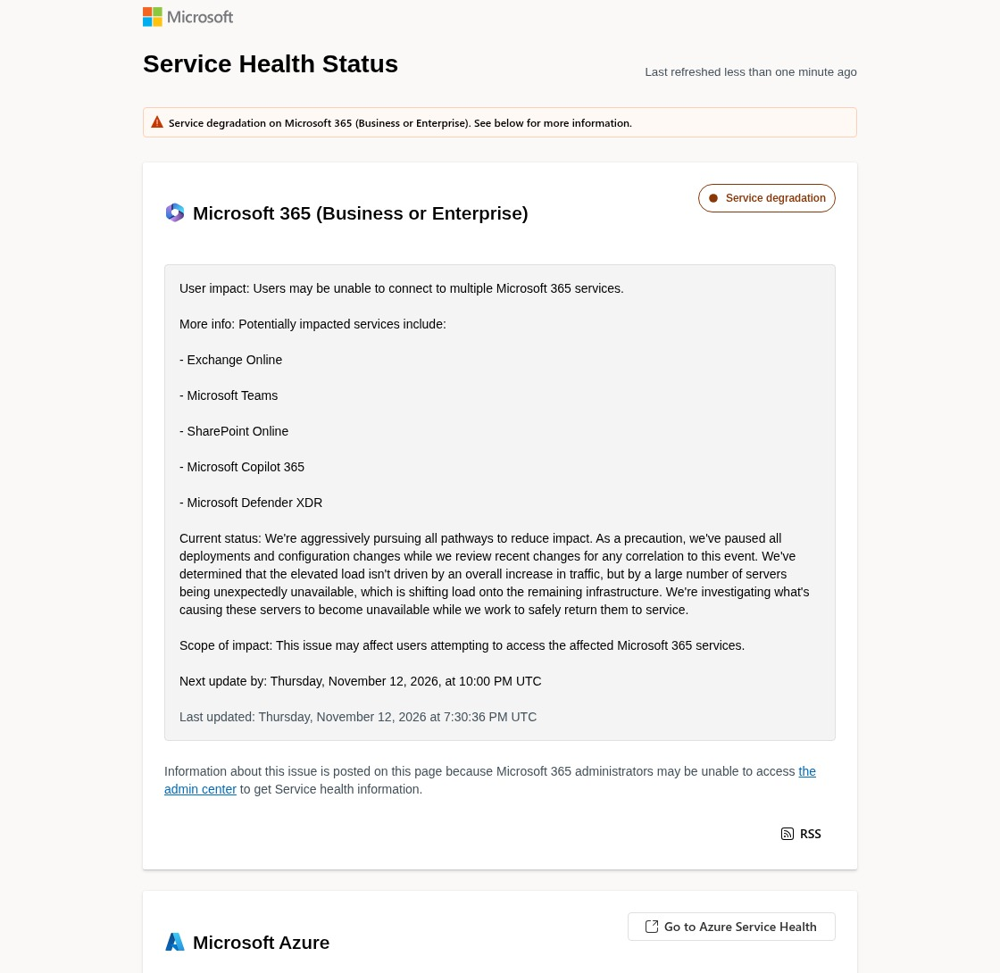

<video controls playsinline preload="metadata" src="/justincredibletech/videos/microsoft-365-outlook-outage.mp4" poster="/justincredibletech/videos/microsoft-365-outlook-outage.png" style="width:100%;max-width:420px;display:block;margin:0 auto 1.5rem;border-radius:12px;"></video>

**Update, Nov. 13, 2026:** The outage continued overnight and into a second day. Microsoft now reports recovery progress, including broader improvements in North America, and has extended the email timeout window to 48 hours. It is still not fully resolved. [Read the Friday morning update](https://justincredibletech.com/blog/microsoft-365-outage-day-two-recovery/).

If your Outlook inbox will not load, or Teams and SharePoint are throwing errors, you are not alone. As of mid-afternoon Central Time on Thursday, November 12, 2026, Microsoft is still reporting a service degradation across Microsoft 365, and the company has not marked the incident resolved.

## What happened

- **When it started.** Microsoft's Exchange Online incident, [EX1550543](https://status.cloud.microsoft/en-us/), lists a start time of 16:17 UTC, which is **10:17 a.m. Central Time**. The company's first public post on the outage came at 11:54 a.m. CT, when [Microsoft 365 Status](https://x.com/MSFT365Status/status/2120938282204688468) said it was investigating reports of users who could not reach Exchange Online mailboxes "through multiple connection methods in the Americas."
- **It spread beyond the Americas.** At 12:07 p.m. CT, Microsoft said the issue "may affect Microsoft 365 service connectivity for users in any region" ([@MSFT365Status](https://x.com/MSFT365Status/status/2120941584220827979)).
- **What is affected.** Microsoft's public status page lists **Exchange Online, Microsoft Teams, SharePoint Online, Microsoft Copilot 365, and Microsoft Defender XDR**. For email, Microsoft has said impacted connection methods may include Outlook on the web, the Messaging API (MAPI), Exchange ActiveSync, and the REST API. [TechCrunch](https://techcrunch.com/2026/11/12/microsofts-outlook-email-hit-by-new-outage/) also reported that consumer OneDrive and Office on the web were unavailable, and [Reuters](https://money.usnews.com/investing/news/articles/2026-11-12/microsoft-365-outlook-down-for-thousands-of-us-users-downdetector-shows) said connectors used by OpenAI and Anthropic were affected as well.
- **Azure is a separate picture.** Microsoft's official status page said at the time of writing, "No Azure issues detected at this time."
- **How big it looks from the outside.** Outage tracker Downdetector recorded **more than 130,000 reports** for Outlook at the peak, around 12:27 p.m. CT, according to [Reuters](https://za.investing.com/news/stock-market-news/microsoft-services-suffer-outages-affecting-hundreds-of-thousands-of-users-4571801) and [Tom's Guide](https://www.tomsguide.com/news/live/microsoft-outlook-down-live-updates-outage-11-12-26). Tom's Guide later put the figure around 77,000 near 1:51 p.m. CT. Downdetector counts are user reports, not a census of every affected account.
- **A different Teams incident earlier in the day.** Microsoft separately investigated a North America Teams issue under TM1550488 and said at 11:09 a.m. CT that impact from that incident was "fully resolved." The outage described here is a later, still-open incident.

*Screenshot of [Microsoft Service Health](https://status.cloud.microsoft/en-us/), captured the afternoon of November 12, 2026, Central Time. The public page's written update was timestamped 7:30 p.m. UTC (1:30 p.m. CT); Microsoft continued posting shorter updates on X after that.*

## What Microsoft says

Microsoft has not published a final root-cause report. What it has confirmed so far is this:

- The company first described "elevated load" on a portion of its infrastructure across multiple regions, and said it had begun redistributing connection traffic across its worldwide network to balance the load ([@MSFT365Status](https://x.com/MSFT365Status/status/2120951972706558431)).
- It later said the elevated load **was not driven by an overall increase in traffic**. Instead, "a large number of servers" became unexpectedly unavailable, shifting work onto the servers that were still up ([@MSFT365Status](https://x.com/MSFT365Status/status/2120962673911181437); [Microsoft Service Health](https://status.cloud.microsoft/en-us/)).
- Microsoft then said affected servers were failing automated health checks, which was taking them out of service. It started a restart of those servers and began testing a configuration change aimed at that health-check problem ([@MSFT365Status](https://x.com/MSFT365Status/status/2120967496303858112)).
- In a further update at 2:19 p.m. CT, Microsoft said it had not identified a recent change correlated with the start of the impact, and that the failed health checks may come from a specific component that processes server health. It also said it had taken steps to prevent additional servers from being taken out of service ([@MSFT365Status](https://x.com/MSFT365Status/status/2120974801388904932)).

Microsoft also paused deployments as a precaution. The incidents to watch are **EX1550543** and **MO1550821**. As of the status page's 1:30 p.m. CT update, the next written update was due by 4:00 p.m. Central Time.

## What you can do

- **Check the official status, not just social media.** Microsoft is posting at [status.cloud.microsoft](https://status.cloud.microsoft/en-us/) and on X at [@MSFT365Status](https://x.com/MSFT365Status). The public status page exists in part because administrators may not be able to reach the Microsoft 365 admin center during this incident.
- **If you are an admin** and the admin center loads, look up incidents EX1550543 and MO1550821.
- **Do not assume the web or mobile app is a workaround.** Microsoft has listed Outlook on the web and other connection methods among those that may be affected, so switching clients may not help.
- **Already-downloaded mail may still be readable.** If the Outlook desktop app was already synced, you may still be able to read messages it stored offline. Sending new mail, or loading anything that needs a live server connection, may still fail.
- **Avoid hammering sign-in.** Repeated login attempts can add load while Microsoft is trying to stabilize the remaining servers.

This post describes the incident as it stood in the mid-afternoon, Central Time, on November 12, 2026. I will update it if Microsoft marks the outage resolved or publishes a root-cause report.

**Are you still locked out, or is access starting to come back? Tell me on X.**
